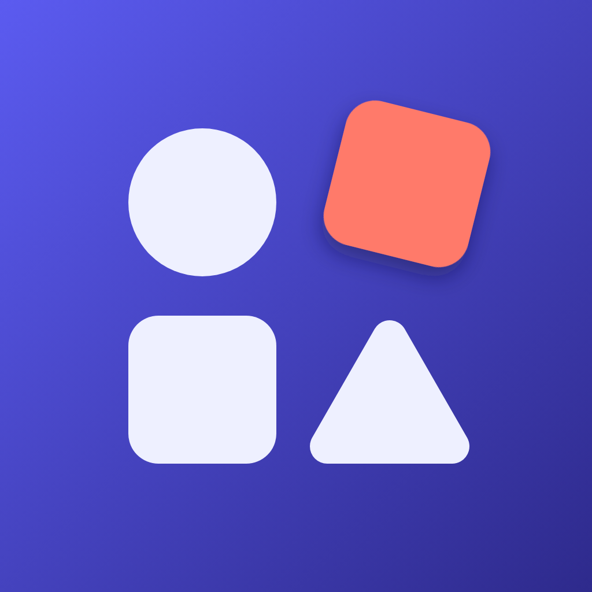

<p align="center"></p>

# toy 工具箱

一个插件化的桌面小工具箱。每个工具都是一个插件：用 Lua、JavaScript 或任意可执行程序写，
界面由插件声明的表单生成，不用写一行界面代码。

程序用 Go 和 [Viva](https://github.com/vivaui/viva) 编写，界面由 GPU 直接绘制，不依赖浏览器内核，
打包后是一个 exe 加一个 `plugins` 目录。

## 自带的工具

| 工具 | 说明 | 插件语言 |
| --- | --- | --- |
| HTTP 请求 | 发送 HTTP 请求，常用请求可以保存、一选即载入 | JavaScript |
| JSON 格式化 | 格式化、压缩 JSON，对象数组可显示成表格 | JavaScript |
| 编解码 | Base64、URL、Hex、HTML 实体、Unicode 转义、JWT 解码 | JavaScript |
| 文本行处理 | 多行文本排序、去重、反转 | Lua |
| 哈希计算 | 文本或文件的 MD5 / SHA 摘要 | exec（Go 程序） |

## 功能

- **左边表单，右边结果**：结果可以是文本或表格，长结果可滚动、一键复制。
- **插件热重载**：改了插件文件，窗口会自动重载，表单里已经填的内容还在。
- **系统托盘**：关闭窗口时可以选择收到托盘继续运行，托盘菜单能直接打开某个工具。
- **单实例**：再次启动只会把已经打开的窗口调出来。
- **插件能力**：存取数据（`get`/`set`）、写剪贴板、汇报进度、发 HTTP 请求、
  动态填充下拉框和表单；按钮可以选样式、要求确认。

## 使用

从 `build/` 运行 `toy.exe`。插件从这些目录加载，后面的目录可以覆盖前面同 id 的插件：

1. 程序所在目录下的 `plugins/`
2. 当前工作目录下的 `plugins/`
3. `%APPDATA%\toy\plugins\`（自己写的插件放这里）

设置保存在 `%APPDATA%\toy\settings.json`，插件存的数据在 `%APPDATA%\toy\data\`。

## 写一个插件

一个插件就是一个目录，里面有 `plugin.toml` 和脚本。例如一个 Lua 插件：

```toml
# plugins/hello/plugin.toml
id = "hello"
name = "问候"
runtime = "lua"
entry = "main.lua"

[[tools]]
id = "hello"
name = "问候"

  [[tools.inputs]]
  id = "name"
  label = "名字"
  required = true

  [[tools.actions]]
  id = "greet"
  label = "打招呼"
```

```lua
-- plugins/hello/main.lua
function run(action, inputs)
  return { result = "你好，" .. inputs.name .. "！" }
end
```

保存后它就出现在侧栏里。表单字段、输出类型、宿主 API 和 exec 协议见 [PLUGINS.md](PLUGINS.md)。

## 开发

需要 Go 1.26。Viva 的命令行工具已在 `go.mod` 里声明，用 `go tool viva` 运行：

```sh
go tool viva dev .      # 运行，保存代码后热重载
go test ./...           # 测试（无窗口驱动真实界面）
go vet ./... && go tool viva vet
go tool viva build      # 打包到 build/
```

打包后把 `plugins/` 复制到 `build/plugins/`，exe 才能找到自带的插件。

目录结构：

```
main.go, page.go, toolview.go, tray.go   窗口、页面、托盘
internal/plugin/        插件发现、清单校验、运行管理
internal/plugin/luart   Lua 运行时
internal/plugin/jsrt    JavaScript 运行时
internal/plugin/execrt  exec 协议（外部程序）
sdk/toyplugin/          用 Go 写 exec 插件的辅助包
plugins/                自带插件
assets/                 图标与 logo
```
